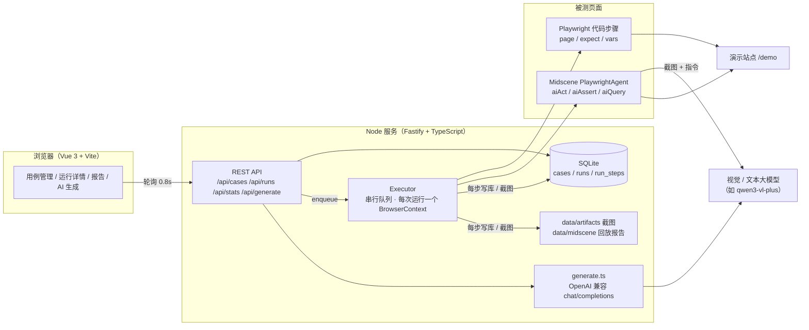

# AI 驱动的 UI 自动化测试平台

在 Web 页面上管理 UI 测试用例、一键执行、查看报告。用例步骤可以写 **Playwright 代码**（选择器，快且确定），也可以写**自然语言**（交给 [Midscene.js](https://midscenejs.com/) 视觉模型看截图执行），两种步骤可以写在同一个用例里。还能粘贴需求文本，让大模型生成用例草稿，人工审核后再入库。

> 定位：帮团队从“手工点页面”过渡到自动化，让不熟悉代码的测试同学先用自然语言写用例，稳定之后再沉淀成选择器脚本。


## 功能

| 模块 | 说明 |
|---|---|
| 用例管理 | 新建 / 编辑 / 删除用例；一个用例 = 目标 URL + 步骤列表；步骤有四种：AI 操作（`aiAct`）、AI 断言（`aiAssert`）、AI 提取（`aiQuery`）、Playwright 代码片段；数据存在 SQLite |
| 一键执行 | 后端用 Playwright 驱动 Chrome 执行；运行进入串行队列异步执行，前端每 0.8 秒轮询一次，实时看到每一步的状态。未配置模型时自然语言步骤标记为“跳过（未配置模型）”，代码步骤照常执行 |
| 测试报告 | 每一步都记录状态、耗时、截图（失败步骤大图展示）、模型调用次数和 token；报告页有运行通过率、平均耗时、每日通过率趋势、最近 30 次耗时柱状图和历史运行列表，可按用例和时间范围筛选 |
| AI 生成用例 | 粘贴需求文本，调用 OpenAI 兼容接口生成用例草稿（自然语言步骤）；草稿可修改、可取消勾选，点“保存”后才入库 |
| 演示站点 | 自带一个离线的被测站点（登录 + 待办列表，账号 `demo / demo123`），另附 3 条示例用例，不联网也能演示整条链路 |

## 快速开始

```bash
npm install
```

```bash
npm run dev
```

打开 <http://localhost:5173>（如果端口被占用，Vite 会自动换一个，以终端输出为准）。首次启动会自动创建 `data/platform.db`，并写入 3 条示例用例。

- 浏览器默认用本机安装的 **Google Chrome**（`BROWSER_CHANNEL=chrome`），不用另外下载 Chromium。没有 Chrome 时，先执行 `npx playwright install chromium`，再在 `.env` 里写 `BROWSER_CHANNEL=`。
- 配置模型：复制 `.env.example` 为 `.env`，填写 `MIDSCENE_MODEL_BASE_URL / MIDSCENE_MODEL_API_KEY / MIDSCENE_MODEL_NAME`，然后重启。用阿里云百炼时，可以用通用地址或工作空间专属地址；视觉模型响应慢，`MIDSCENE_MODEL_TIMEOUT` 建议设为 120000。`.env` 已加入 `.gitignore`。
- 生产方式运行：`npm run build && npm start`，由同一个端口（默认 3100）同时提供前端、API 和演示站点。

## 测试

```bash
npm test            # vitest：43 条单元 / 集成测试
```

```bash
npm run test:e2e    # Playwright：8 条平台自身的端到端测试（会先构建前端）
```

```bash
npm run typecheck   # tsc + vue-tsc
```

- **单元测试**：用例校验、URL 占位符、代码片段编译与超时、运行结论推导、模型输出的 JSON 解析（代码块包裹、类型别名、无效步骤丢弃）、OpenAI 兼容请求格式。
- **集成测试**（`tests/unit/platform.test.ts`）：真实 Fastify + 内存 SQLite + 本机 Chrome 跑演示站点。自然语言步骤由注入的**假 Agent** 执行，用来验证跳过逻辑、每步 token 统计、失败截图、失败后的步骤标记为“未执行”、`vars` 传值、统计口径。
- **E2E**（`e2e/`）：起两个互相隔离的平台实例。`nomodel` 实例验证“新建 → 执行 → 报告”、失败截图、跳过提示、编辑删除和表单校验；`mockmodel` 实例指向本地假模型（`e2e/mock-llm.ts`），验证“生成 → 审核 → 入库”的流程。假模型只用于测试流程，**不代表真实模型的生成效果**。

## 架构



目录结构：

```
server/
  app.ts            路由（用例、执行、统计、生成）
  runner/executor.ts  执行器：队列、浏览器复用、逐步执行、截图、用量差值
  runner/steps.ts     代码片段编译与超时、运行结论推导
  runner/ai.ts        Midscene Agent 工厂（可替换，便于测试）
  ai/generate.ts      需求 → 用例草稿（提示词、调用、解析）
  repo/               SQLite 读写与统计
  demo-site/          演示被测站点
shared/types.ts     前后端共用的类型
web/src/            Vue 页面与组件（含手写的 SVG 趋势图）
tests/unit/         vitest
e2e/                平台自身的 Playwright E2E 与假模型
```

## 截图

| 运行失败：错误信息 + 失败截图 | 运行通过：AI 步骤因未配置模型被跳过 |
|---|---|
|  |  |

| 测试报告 | 用例编辑 |
|---|---|
|  |  |

| AI 生成：未配置模型时的提示 | AI 生成：草稿审核（截图里的数据来自 E2E 假模型） |
|---|---|
|  |  |

截图由 `npx tsx scripts/screenshots.ts <平台地址> [假模型实例地址]` 生成。

## 设计取舍

### 什么时候用视觉断言，什么时候用选择器

|  | 选择器（Playwright 代码） | 视觉断言 / 操作（Midscene） |
|---|---|---|
| 速度 | 毫秒级 | 每次都要调用视觉模型，以秒计 |
| 成本 | 0 | 每次调用都消耗 token（报告里逐步记录） |
| 确定性 | 结果确定，可重复 | 依赖模型判断，存在误判 |
| 抗 DOM 变化 | 测试标记、结构一变就挂 | 只看界面，DOM 重构不影响 |
| 编写门槛 | 需要会写代码、找定位器 | 会描述界面就能写 |

作者在毕设（在线考试智能监考系统）中做过对比实验：把页面上的测试标记删掉后，选择器断言的通过率降到 40%，视觉断言仍是 100%；但单个视觉断言比选择器断言慢约两百倍，每次约消耗 8500 token。

据此，本平台的建议是：

1. **操作优先用选择器**：登录、填表这类高频前置步骤用代码步骤，执行快、结果稳定（见示例用例 2）。
2. **“看起来对不对”交给视觉断言**：比如样式、布局、提示是否显眼，或者没有稳定选择器的第三方组件，选择器很难表达这类检查。
3. **探索期用自然语言，稳定后沉淀**：新功能先用自然语言快速覆盖（也可以用 AI 生成草稿），稳定的主流程再改写成代码步骤，以降低每次运行的模型成本。报告中逐步显示的 token，就是判断哪些步骤值得沉淀的依据。
4. **同一个用例可以混写**：代码步骤可以通过 `vars.stepN` 读取 AI 提取步骤的结果，用 AI 取数据、用代码做精确比较。

### 其他取舍

- **未配置模型时“跳过”而不是“失败”**：这样不会因为环境缺少 key 把整条流水线标红。只要有一步失败，整次运行就判为失败；部分步骤跳过仍算通过（报告里有醒目提示）；全部步骤都被跳过时记为“跳过”，不计入通过率。
- **失败即停**：某一步失败后，剩余步骤标记为“未执行”，不再继续，避免后续报错掩盖真正的失败点。每一步都截图（JPEG，体积小），失败步骤在报告中大图展示。
- **串行队列 + 轮询**：MVP 阶段只复用一个浏览器实例，每次运行新建一个 BrowserContext，彼此隔离。每一步结束就写库，前端轮询即可看到实时进度，比 SSE 简单，也不怕连接中断。要并发执行时，扩展成 worker 池即可。
- **token 统计**：Midscene Agent 的 `metrics` 是累计值，执行器在每一步前后各取一次，差值就是这一步的模型调用次数和 token。
- **AI 生成只出草稿**：生成接口不写库，前端审核后再调用常规的新建接口入库，并经过同一套校验。模型输出用宽松的方式解析（兼容代码块和类型别名），不合规的步骤直接丢弃。
- **代码步骤的安全边界**：代码片段在平台进程内执行（`AsyncFunction`），只适合内网的可信用户使用。要对外开放时，应该把执行器放进独立的容器或 worker 中隔离。
- **数据库**：用 SQLite（better-sqlite3，同步 API），单文件、零运维，适合 MVP。`runs` 表冗余保存了用例名，用例改名或删除后，历史报告依然可读。

## 已知限制

- 本仓库的自动化测试都没有调用真实模型（自然语言步骤由假 Agent 或假模型代替）。真实的视觉执行效果和 token 数据，需要配置 key 后实际运行才能看到。
- 暂不支持并发执行、定时任务、多用户权限和 CI 触发接口。
