# AI 驱动的 UI 自动化测试平台

[](https://github.com/peiyaoc48-bit/ai-test-platform/actions/workflows/ci.yml)

在 Web 页面上管理测试用例、一键执行、查看报告。用例步骤可以写 **Playwright 代码**（选择器，快且确定）、**自然语言**（交给 [Midscene.js](https://midscenejs.com/) 视觉模型看截图执行）或**接口请求**（YAML 描述请求、断言和变量提取），几种步骤可以写在同一个用例里。用例可以组成用例集批量运行，导出 JUnit 报告接入 CI，也可以导出为独立运行的 Playwright 脚本。同一套用例可以在不同环境（地址、变量、浏览器参数、权限、预置登录态）下运行。平台还能注入界面变更来检验用例的鲁棒性，代码步骤选择器失效时可以由 AI 兜底（自愈）。还能粘贴需求文本，让大模型生成用例草稿，人工审核后再入库。

> **在线演示：<https://test.yaojade.top>**（访客只读，可以运行示例用例）
>
> 实战：用这个平台测试作者的毕业设计“在线考试智能监考系统”（Spring Boot + Vue，JWT，摄像头人脸检测），见 [examples/proctor](examples/proctor/README.md)。

> 定位：帮团队从“手工点页面”过渡到自动化，让不熟悉代码的测试同学先用自然语言写用例，稳定之后再沉淀成选择器脚本。

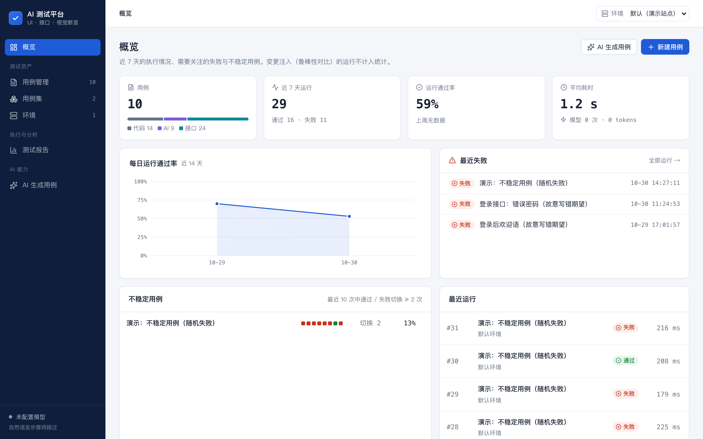

## 功能

| 模块 | 说明 |
|---|---|
| 概览 | 近 7 天运行数、通过率（与上周对比）、平均耗时与模型 token；最近失败的用例；**不稳定用例识别**（参考 Allure TestOps：最近 10 次运行中通过 / 失败切换 ≥ 2 次）；用例的步骤构成 |
| 用例管理 | 搜索与筛选（步骤类型、最近结果）；新建 / 编辑 / 删除用例，代码与 YAML 步骤带语法高亮，步骤可拖拽排序，⌘S 保存，“保存并运行”；一个用例 = 目标 URL + 步骤列表；步骤有五种：AI 操作（`aiAct`）、AI 断言（`aiAssert`）、AI 提取（`aiQuery`）、Playwright 代码片段、接口请求；数据存在 SQLite |
| 接口测试 | 接口步骤用 YAML 描述 `method / url / headers / json`，断言状态码、响应耗时、响应头和 JSON 字段（`eq / exists / contains / len / gt / lt / type`），用 `extract` 提取变量供后续步骤引用（接口关联）。纯接口用例不启动浏览器，报告展示请求与响应（鉴权头脱敏） |
| 一键执行 | 后端用 Playwright 驱动 Chrome 执行；运行进入串行队列异步执行，前端每 0.8 秒轮询一次，实时看到每一步的状态。未配置模型时自然语言步骤标记为“跳过（未配置模型）”，代码步骤照常执行 |
| 测试报告 | 运行详情参考 Playwright Trace Viewer：左侧步骤时间线（状态与耗时条），右侧为选中步骤的代码、错误、请求 / 响应和截图，自动定位到失败步骤，↑ ↓ 切换；每一步都记录状态、耗时、截图、模型调用次数和 token；报告页有运行通过率、平均耗时、每日通过率趋势、最近 30 次耗时柱状图和历史运行列表，可按用例和时间范围筛选 |
| 环境 | 每个环境配置基础地址、变量、Chromium 启动参数（如模拟摄像头）、权限、预置 localStorage、单步超时；顶栏切换当前环境，用例集可设默认环境，CI 脚本支持 `--env`。用例 URL 写成 `{{BASE_URL}}/login`，换环境不用改用例；运行时保存环境快照，历史报告可追溯 |
| 鲁棒性对比 | 变更注入：在测试浏览器里去掉 `data-test` 等测试标记，或换一套视觉样式（不改被测系统）。一键让同一用例在“无变更 / 去掉测试标记 / 更换视觉样式”下各跑一次（失败后继续执行），矩阵对比每一步、每种写法的存活率 |
| AI 兜底（自愈） | 代码步骤可附一句自然语言描述：选择器失效导致失败时，改由视觉模型按描述执行；通过则标记“已自愈”，并提示更新选择器 |
| 导出脚本 | 用例导出为可独立运行的 `.spec.ts`：代码原样输出，AI 步骤用 Midscene fixture，接口步骤翻译为 `request` + `expect`，环境配置转成 `test.use` |
| Midscene 缓存 | 按用例缓存 AI 规划与元素定位，重复运行时减少模型调用；变更注入的运行不使用缓存，避免影响对比结果 |
| 用例集与 CI | 用例可以组成用例集，或在列表里勾选多个用例批量运行；批次页显示进度与汇总，可下载 JUnit XML。`npm run ci:run -- --suite 冒烟` 触发用例集并轮询到结束，有失败时以非 0 退出，让流水线变红 |
| 用例工坊 | 需求文档 → AI 解析为**带原文摘录的需求点**（摘录在原文中找不到时标红，提示模型可能编造）→ 按批次生成用例草稿（记录模型、Prompt 版本、输入指纹）→ **审核工作台**逐条判定：通过 / 修改后通过 / 废弃（必选原因），快捷键操作，原稿不可改、终稿另存 → 入库并关联需求点。度量：采纳率（95% Wilson 置信区间）、直接采纳率、平均修改步数、废弃原因分布、生成即跑通率、每条采纳用例的 token；两批对比用 Fisher 精确检验。**需求覆盖矩阵**区分“已关联”和“已验证”（关联用例最近一次运行通过），P0 未覆盖告警，可只针对缺口补生成，导出 CSV |
| 快速生成 | 粘贴需求文本直接生成用例草稿，勾选后入库；不记录批次和审核结果 |
| 演示站点 | 自带一个离线的被测站点：页面（登录 + 待办列表，账号 `demo / demo123`）和后端接口 `/demo-api`（登录发放 token，带 token 增删改查待办，每个会话的数据互相隔离）。另附 4 条示例用例和一个“冒烟”用例集，不联网也能演示整条链路 |

## 快速开始

```bash
npm install
```

```bash
npm run dev
```

打开 <http://localhost:5173>（如果端口被占用，Vite 会自动换一个，以终端输出为准）。首次启动会自动创建 `data/platform.db`，并写入 4 条示例用例和“冒烟”用例集。

- 浏览器默认用本机安装的 **Google Chrome**（`BROWSER_CHANNEL=chrome`），不用另外下载 Chromium。没有 Chrome 时，先执行 `npx playwright install chromium`，再在 `.env` 里写 `BROWSER_CHANNEL=`。
- 配置模型：复制 `.env.example` 为 `.env`，填写 `MIDSCENE_MODEL_BASE_URL / MIDSCENE_MODEL_API_KEY / MIDSCENE_MODEL_NAME`，然后重启。用阿里云百炼时，可以用通用地址或工作空间专属地址；视觉模型响应慢，`MIDSCENE_MODEL_TIMEOUT` 建议设为 120000。`.env` 已加入 `.gitignore`。
- 生产方式运行：`npm run build && npm start`，由同一个端口（默认 3100）同时提供前端、API 和演示站点。
- 部署到服务器：`docker compose up -d --build`，配合 Nginx + HTTPS，详见 [deploy/README.md](deploy/README.md)。公网部署时设置 `ACCESS_CODE`（登录后可编辑）和 `PUBLIC_DEMO=true`（访客只读浏览、可运行示例用例）。

## 测试

```bash
npm test            # vitest：171 条单元 / 集成测试
```

```bash
npm run test:e2e    # Playwright：16 条平台自身的端到端测试（会先构建前端）
```

```bash
npm run test:api:setup && npm run test:api   # pytest：100 条接口自动化用例（见 api-tests/README.md）
```

```bash
npm run typecheck   # tsc + vue-tsc
```

- **单元测试**：用例校验、URL 占位符、代码片段编译与超时、运行结论推导、模型输出的 JSON 解析（代码块包裹、类型别名、无效步骤丢弃）、OpenAI 兼容请求格式。
- **导出脚本的回归**：集成测试里把用例导出为 `.spec.ts`，再用 Playwright 真实运行导出的文件。
- **集成测试**（`tests/unit/platform.test.ts`）：真实 Fastify + 内存 SQLite + 本机 Chrome 跑演示站点。自然语言步骤由注入的**假 Agent** 执行，用来验证跳过逻辑、每步 token 统计、失败截图、失败后的步骤标记为“未执行”、`vars` 传值、统计口径。
- **接口自动化**（`api-tests/`，Python）：pytest + requests 分层框架（客户端 / 契约 / 断言 / YAML 数据 / 夹具），测平台接口和演示站点接口：CRUD 与 JSON Schema 契约、数据驱动的参数校验与边界值、登录鉴权与 token 关联、异步接口“提交 → 轮询”、统计口径、CI 脚本的退出码。
- **CI**（`.github/workflows/ci.yml`）：类型检查 → vitest → E2E → pytest → 启动平台执行“冒烟”用例集，并上传全部报告。
- **E2E**（`e2e/`）：起两个互相隔离的平台实例。`nomodel` 实例验证“新建 → 执行 → 报告”、失败截图、跳过提示、编辑删除和表单校验；`mockmodel` 实例指向本地假模型（`e2e/mock-llm.ts`），验证“生成 → 审核 → 入库”的流程。假模型只用于测试流程，**不代表真实模型的生成效果**。

## 架构

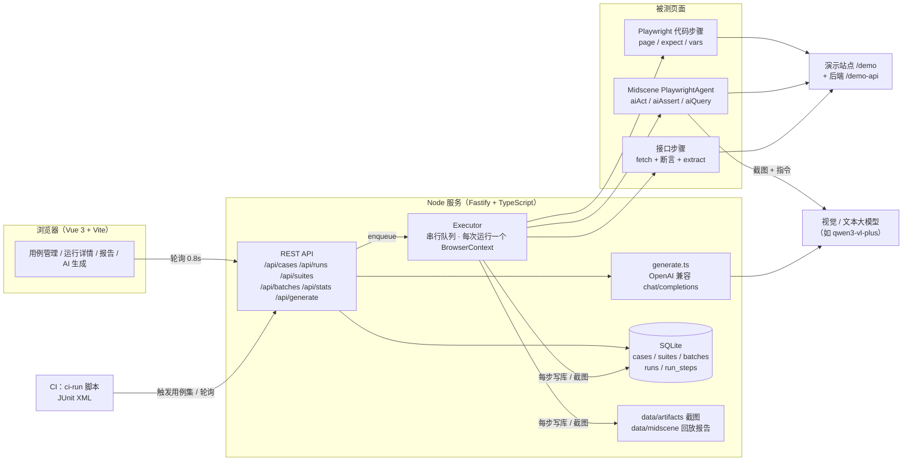

目录结构：

```
server/
  app.ts            路由（用例、执行、用例集与批次、统计、生成）
  runner/executor.ts  执行器：队列、浏览器按需启动、逐步执行、截图、用量差值
  runner/steps.ts     代码片段编译与超时、运行结论推导
  runner/api-step.ts  接口步骤：YAML 解析、变量渲染（含动态变量）、请求、断言、变量提取
  runner/mutations.ts 变更注入脚本（去掉测试标记 / 更换视觉样式）
  report/export.ts    导出为 Playwright 测试文件
  env.ts              环境变量合并与 URL 模板解析
  report/junit.ts     批次导出 JUnit XML
  demo-api.ts         演示站点后端（登录鉴权 + 待办增删改查）
  runner/ai.ts        Midscene Agent 工厂（可替换，便于测试）
  ai/generate.ts      快速生成：需求 → 用例草稿（提示词、调用、解析）
  ai/workshop.ts      用例工坊：Prompt 版本、需求点解析与摘录校验、按需求点生成、重新解析时的编号沿用
  ai/stats.ts         度量：Wilson 置信区间、Fisher 精确检验、审核修改量（步骤 LCS 对齐）
  ai/prompts/         Prompt 版本文件（parse-vN.md / gen-vN.md，只增不改）
  workshop-routes.ts  用例工坊接口
  repo/workshop.ts    需求、需求点、生成批次、草稿审核、覆盖矩阵
  repo/               SQLite 读写、统计与概览（不稳定用例识别）
  demo-site/          演示被测站点
shared/types.ts     前后端共用的类型
web/src/            Vue 页面与组件（含手写的 SVG 趋势图、CodeMirror 编辑器、提示与确认弹窗）
tests/unit/         vitest
e2e/                平台自身的 Playwright E2E 与假模型
api-tests/          Python 接口自动化（pytest + requests）
scripts/ci-run.ts   CI 触发脚本
examples/proctor/   实战：测试毕设“在线考试智能监考系统”
.github/workflows/  GitHub Actions
```

## 截图

| 用例管理：搜索、筛选、批量运行 | 用例编辑：代码 / YAML 高亮、拖拽排序、AI 兜底 |
|---|---|
| 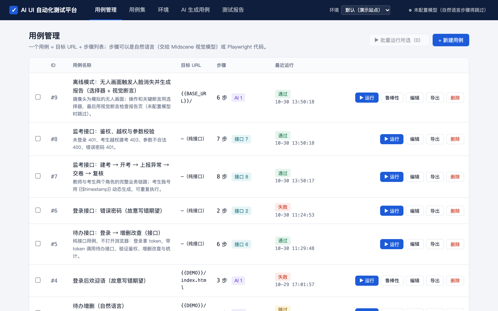 | 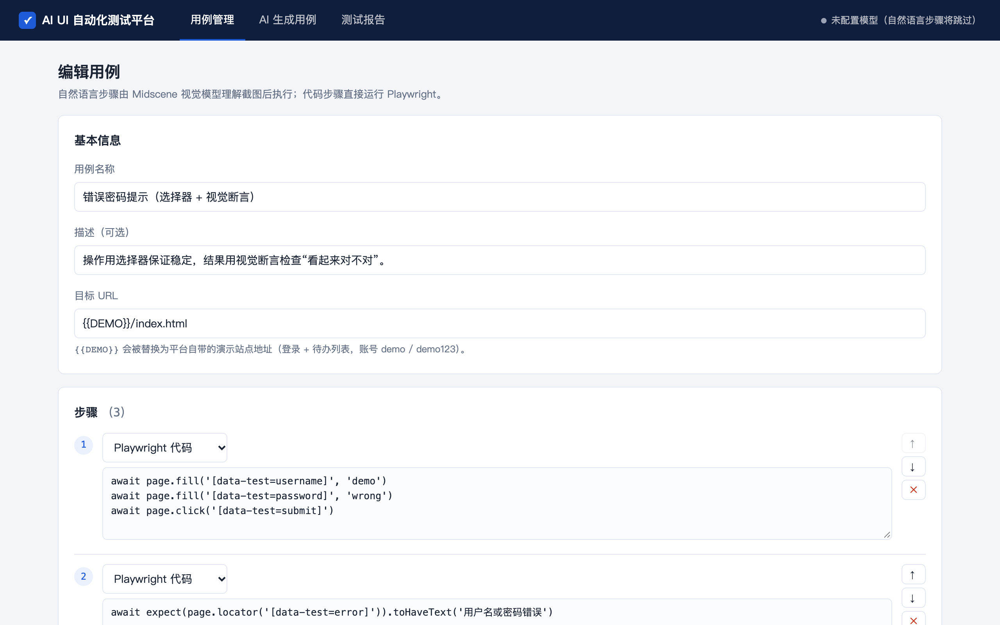 |

| 运行失败：步骤时间线 + 错误与截图 | 运行通过：AI 步骤因未配置模型被跳过 |
|---|---|
| 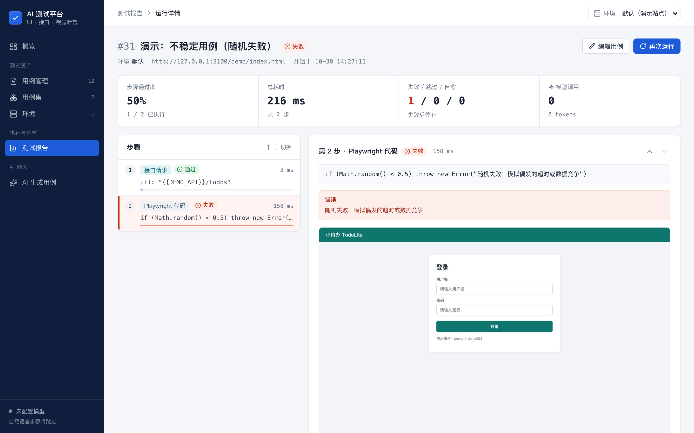 | 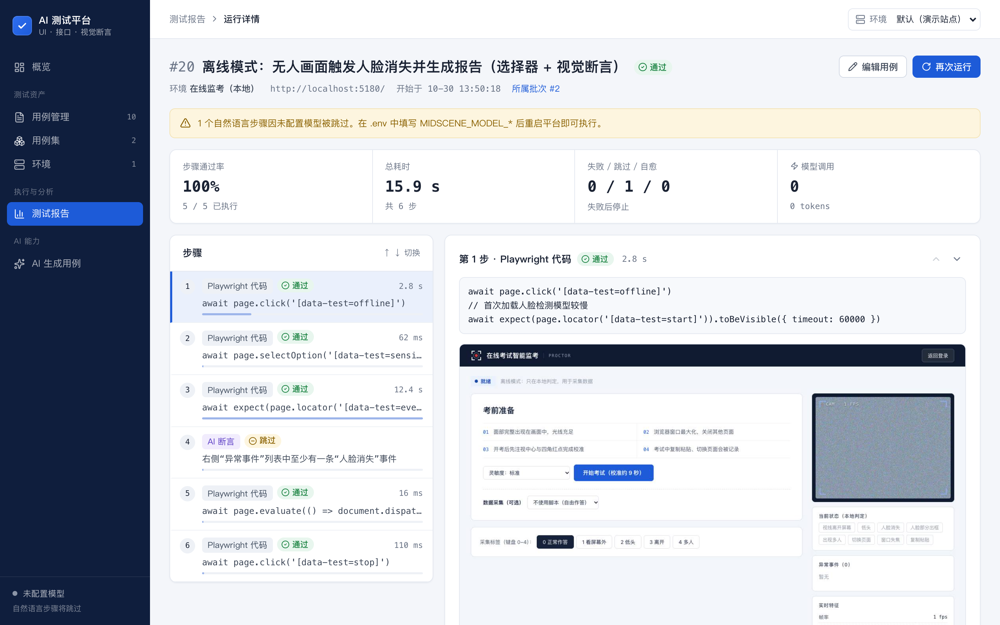 |

| 测试报告 | 环境列表 |
|---|---|
| 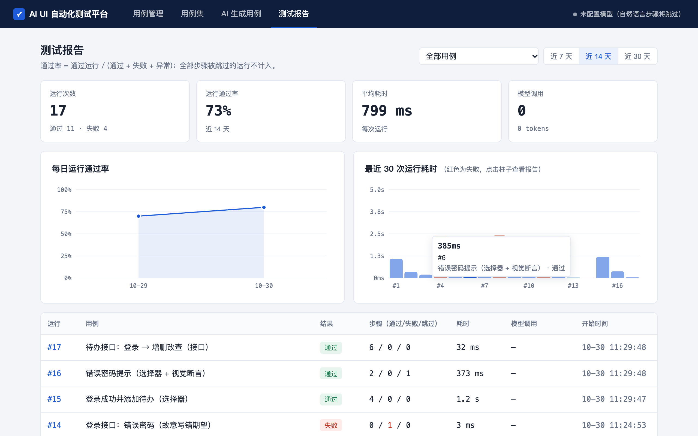 | 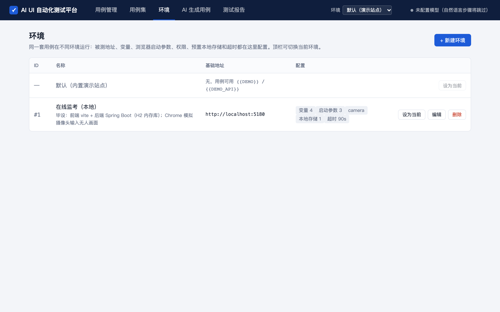 |

| 鲁棒性对比：去掉测试标记后选择器全部失效 | 环境配置（毕设：模拟摄像头、权限、预置协议标记） |
|---|---|
| 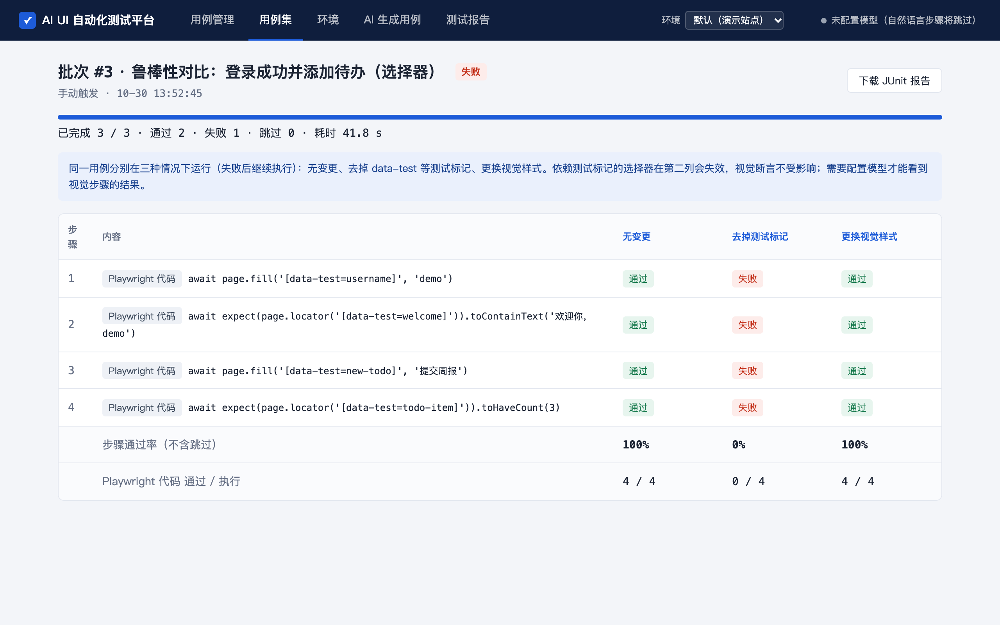 | 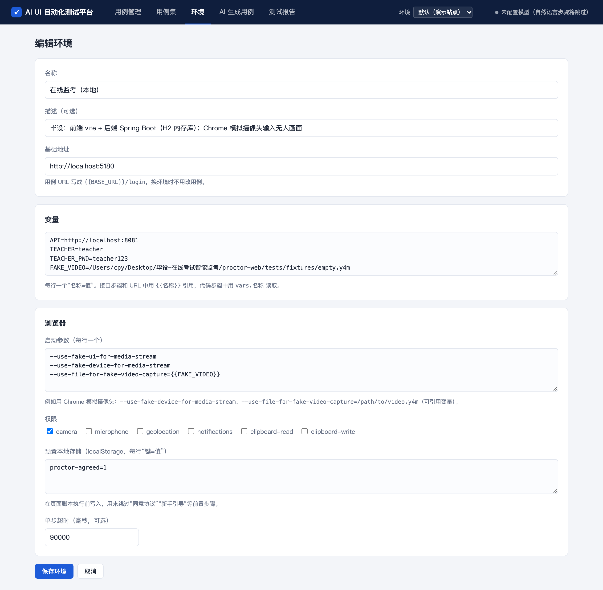 |

| 用平台测毕设：UI 用例（模拟摄像头输入无人画面） | 用平台测毕设：接口业务链路 |
|---|---|
|  | 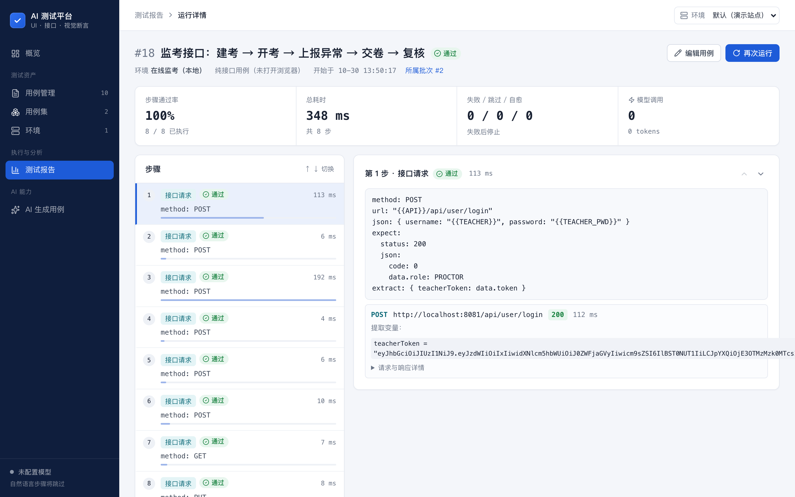 |

| 接口步骤：请求、断言、提取的变量 | 用例集批量运行（可下载 JUnit） |
|---|---|
| 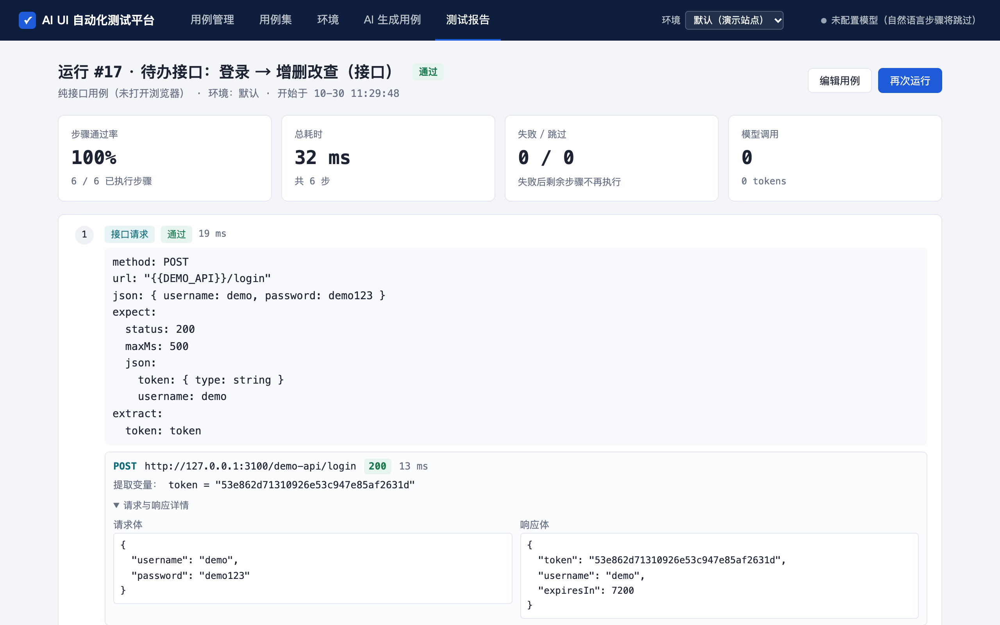 | 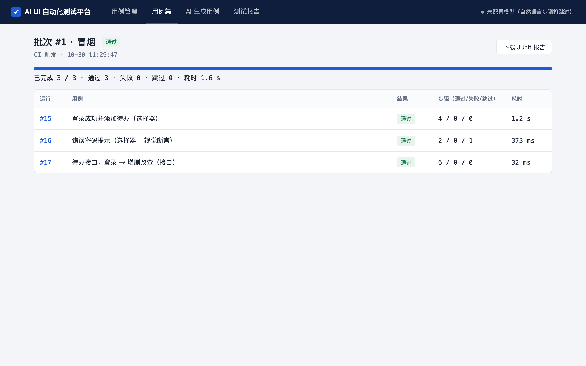 |

| AI 生成：未配置模型时的提示 | AI 生成：草稿审核（截图里的数据来自 E2E 假模型） |
|---|---|
| 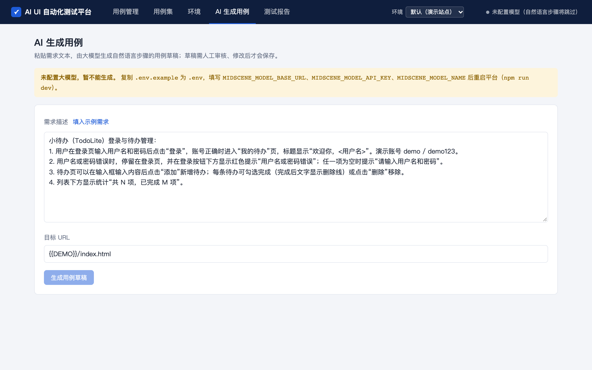 | 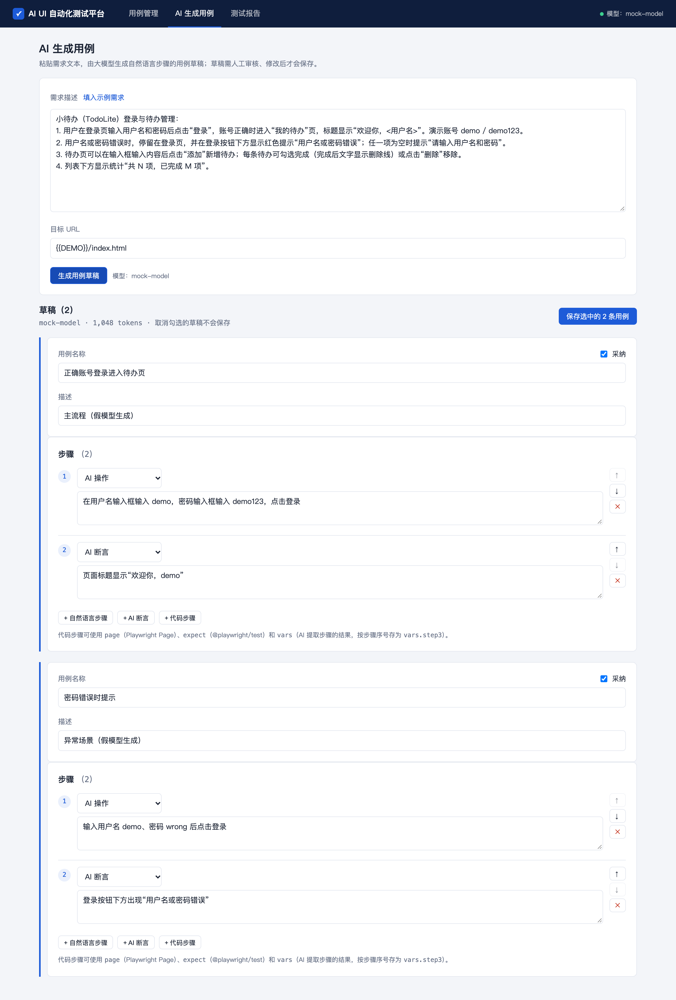 |

截图由 `npx tsx scripts/screenshots.ts <平台地址> [假模型实例地址]` 生成。

## 设计取舍

### 什么时候用视觉断言，什么时候用选择器

|  | 选择器（Playwright 代码） | 视觉断言 / 操作（Midscene） |
|---|---|---|
| 速度 | 毫秒级 | 每次都要调用视觉模型，以秒计 |
| 成本 | 0 | 每次调用都消耗 token（报告里逐步记录） |
| 确定性 | 结果确定，可重复 | 依赖模型判断，存在误判 |
| 抗 DOM 变化 | 测试标记、结构一变就挂 | 只看界面，DOM 重构不影响 |
| 编写门槛 | 需要会写代码、找定位器 | 会描述界面就能写 |

作者在毕设（在线考试智能监考系统）中做过对比实验：把页面上的测试标记删掉后，选择器断言的通过率降到 40%，视觉断言仍是 100%；但单个视觉断言比选择器断言慢约两百倍，每次约消耗 8500 token。

据此，本平台的建议是：

1. **操作优先用选择器**：登录、填表这类高频前置步骤用代码步骤，执行快、结果稳定（见示例用例 2）。
2. **“看起来对不对”交给视觉断言**：比如样式、布局、提示是否显眼，或者没有稳定选择器的第三方组件，选择器很难表达这类检查。
3. **探索期用自然语言，稳定后沉淀**：新功能先用自然语言快速覆盖（也可以用 AI 生成草稿），稳定的主流程再改写成代码步骤，以降低每次运行的模型成本。报告中逐步显示的 token，就是判断哪些步骤值得沉淀的依据。
4. **同一个用例可以混写**：代码步骤可以通过 `vars.stepN` 读取 AI 提取步骤的结果，用 AI 取数据、用代码做精确比较。

### 鲁棒性对比与自愈

毕设里的对比实验是手工跑脚本做的，平台把它变成了一个按钮：选一个用例点“鲁棒性”，平台会在三种情况下各跑一次，每一步的结果排成矩阵。在演示站点上的一次实际运行中，纯选择器用例在“去掉测试标记”下 0/4 存活，在“更换视觉样式”下 4/4 存活。按占位符文字定位（`getByPlaceholder`）的步骤在去掉测试标记后仍然有效（见集成测试），说明“用什么定位”本身就是鲁棒性的一部分。

自愈只在代码步骤失败、且用例作者写了兜底描述时触发，并且会明确标记“已自愈”：它的目的是先让回归不被误报阻塞，同时提醒维护者修选择器，而不是悄悄掩盖问题。变更注入的运行不使用 Midscene 缓存，否则缓存的定位结果会让对比失真。

### 用例工坊：把“AI 生成得好不好”当成评测问题

很多平台的 AI 生成只回答“能不能生成”，这里关心的是“生成的东西有多少能用、需求测全了没有”：

- **AI 只起草**：生成结果是草稿，不进用例列表、不计入覆盖；只有人判定后才入库。原稿不可修改、终稿另存，所以能统计修改率，也能回答“AI 原来写的是什么、人改了什么”。
- **需求点必须带原文摘录**：平台检查摘录能否在原文里找到（忽略空白、标点和全半角），找不到就标红。这是一个便宜但有效的幻觉检查。
- **Prompt 文件化、只增不改**：每批记录 Prompt 版本和输入指纹（Prompt 版本 + 需求点内容的哈希），指纹相同的两批才是可比的；改 Prompt 必须新建版本文件，否则历史批次的采纳率就失去意义。
- **小样本不夸大**：一批通常只有二三十条，采纳率同时给出 Wilson 置信区间；对比两批用 Fisher 精确检验，每组少于 20 条时页面直接提示“结论仅供参考”。
- **关联 ≠ 通过**：覆盖矩阵里“已关联”只说明有用例声称覆盖了这个需求点，“已验证”要求关联用例最近一次（无变更注入的）运行通过。
- **重新解析不打乱关联**：需求文档改版后重新解析，新旧需求点按标题相似度（字符二元组 Dice 系数）贪心匹配，匹配上的沿用编号和用例关联；人工新增的需求点不会被重新解析移除；编号不复用。

### 其他取舍

- **接口步骤用 YAML 而不是代码**：请求、断言、提取都是声明式的，不会写代码的同学也能维护，保存时就能校验语法；需要复杂逻辑时，同一个用例里仍可写代码步骤，并通过 `vars` 读取接口提取的变量。断言失败时一次性列出所有不符合的点，而不是只报第一个。
- **接口和页面混用**：先用接口造数据（快、稳定），再到页面上验证展示，比全程点页面快一个数量级；纯接口用例完全不启动浏览器。
- **批次与 JUnit**：一次批量执行就是一个批次，批次状态由所含运行推导，不单独存状态，避免不一致。导出 JUnit 是为了直接接入 Jenkins / GitLab / GitHub Actions 的测试报告展示；CI 脚本通过退出码让流水线变红。

- **未配置模型时“跳过”而不是“失败”**：这样不会因为环境缺少 key 把整条流水线标红。只要有一步失败，整次运行就判为失败；部分步骤跳过仍算通过（报告里有醒目提示）；全部步骤都被跳过时记为“跳过”，不计入通过率。
- **失败即停**：某一步失败后，剩余步骤标记为“未执行”，不再继续，避免后续报错掩盖真正的失败点。每一步都截图（JPEG，体积小），失败步骤在报告中大图展示。
- **串行队列 + 轮询**：MVP 阶段只复用一个浏览器实例，每次运行新建一个 BrowserContext，彼此隔离。每一步结束就写库，前端轮询即可看到实时进度，比 SSE 简单，也不怕连接中断。要并发执行时，扩展成 worker 池即可。
- **token 统计**：Midscene Agent 的 `metrics` 是累计值，执行器在每一步前后各取一次，差值就是这一步的模型调用次数和 token。
- **AI 生成只出草稿**：生成接口不写库，前端审核后再调用常规的新建接口入库，并经过同一套校验。模型输出用宽松的方式解析（兼容代码块和类型别名），不合规的步骤直接丢弃。
- **代码步骤的安全边界**：代码片段在平台进程内执行（`AsyncFunction`），只适合内网的可信用户使用。要对外开放时，应该把执行器放进独立的容器或 worker 中隔离。
- **数据库**：用 SQLite（better-sqlite3，同步 API），单文件、零运维，适合 MVP。`runs` 表冗余保存了用例名，用例改名或删除后，历史报告依然可读。

## 已知限制

- 本仓库的自动化测试都没有调用真实模型（自然语言步骤由假 Agent 或假模型代替）。用例工坊的采纳率等度量需要用真实模型生成、由人实际审核后才有意义，目前还没有真实数据。真实的视觉执行效果和 token 数据，需要配置 key 后实际运行才能看到。
- 执行队列是串行的（一次一个运行）；暂不支持并发执行、定时任务和多用户权限。
- 视觉模型相关的功能（AI 步骤、AI 兜底、Midscene 缓存）在本仓库的测试里由假 Agent 代替，还没有用真实模型 key 跑过。
