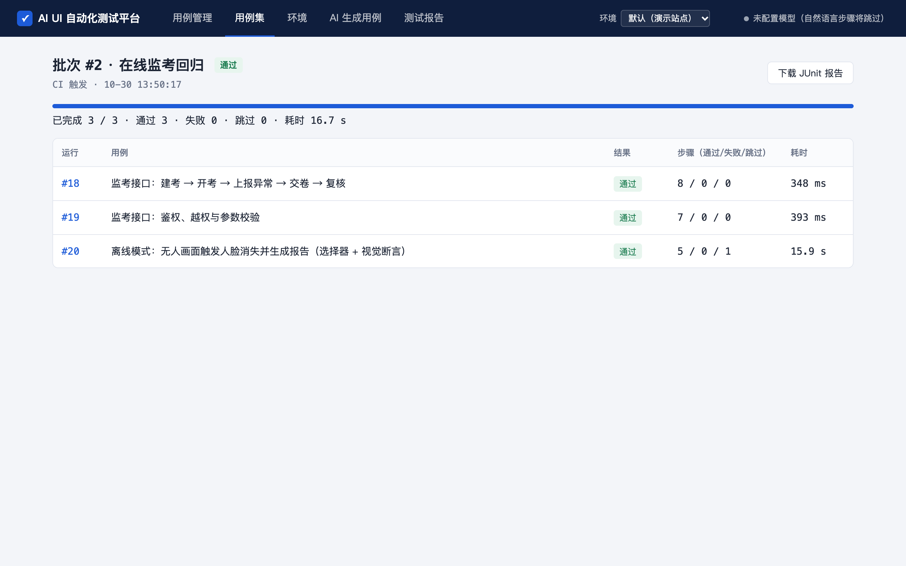

# 实战：用平台测试“在线考试智能监考系统”

被测系统是作者的毕业设计：Vue 前端，Spring Boot 后端（JWT 鉴权，教师 / 考生两种角色），前端通过摄像头做人脸与视线检测，后端判定可疑行为、生成报告并支持教师复核。这里只通过平台去测它，不修改被测系统的代码。



## 1. 启动被测系统（测试配置：H2 内存库，每次启动都是干净数据）

```bash
cd ~/Desktop/毕设-在线考试智能监考/proctor-server
JAVA_HOME=$(/usr/libexec/java_home -v 17) ./mvnw -q spring-boot:run \
  -Dspring-boot.run.arguments="--server.port=8081 --spring.datasource.url=jdbc:h2:mem:atp;MODE=MySQL;DATABASE_TO_LOWER=TRUE;NON_KEYWORDS=USER;DB_CLOSE_DELAY=-1 --proctor.evidence-dir=target/atp-evidence"
```

```bash
cd ~/Desktop/毕设-在线考试智能监考/proctor-web
API_TARGET=http://localhost:8081 npx vite --port 5180 --strictPort
```

## 2. 写入环境、用例和用例集，然后运行

```bash
npx tsx examples/proctor/seed.ts
```

```bash
npm run ci:run -- --suite 在线监考回归
```

## 写入的内容

**环境“在线监考（本地）”**

| 配置 | 值 | 作用 |
|---|---|---|
| 基础地址 | `http://localhost:5180` | UI 用例的 URL 写成 `{{BASE_URL}}/` |
| 变量 | `API`、`TEACHER`、`TEACHER_PWD`、`FAKE_VIDEO` | 接口步骤里引用；换环境不用改用例 |
| 启动参数 | `--use-fake-device-for-media-stream`、`--use-file-for-fake-video-capture={{FAKE_VIDEO}}` 等 | 用一段“无人画面”视频模拟摄像头 |
| 权限 | `camera` | 免去浏览器的摄像头授权弹窗 |
| 预置本地存储 | `proctor-agreed=1` | 跳过“同意用户协议”页面 |
| 单步超时 | 90 秒 | 首次加载人脸检测模型较慢 |

**用例**

1. **监考接口：建考 → 开考 → 上报异常 → 交卷 → 复核**（8 个接口步骤）：教师登录拿 token，创建考试；考生用 `stu{{$timestamp}}` 注册，保证可以重复执行；开考后上报一个“人脸连续消失 6 秒”的窗口，断言判定为 `SUSPICIOUS / FACE_ABSENT` 且需要告警；交卷后教师查看报告，确认事件待复核，再复核为 `CONFIRMED`。整条链路用 `extract` 串起 token、examId、sessionId、eventId。
2. **监考接口：鉴权、越权与参数校验**（7 个接口步骤）：未登录 401、考生越权创建考试 403、时长 0 分钟和用户名过短 400、错误密码 401。
3. **离线模式：无人画面触发人脸消失并生成报告**（UI）：在模拟摄像头下开考，等待“人脸消失”事件，模拟复制操作，结束后检查报告。其中一步是视觉断言，未配置模型时跳过。

在作者本机的一次实际运行中，3 个用例全部通过：两个接口用例各约 0.3 ~ 0.4 秒，UI 用例约 16 秒（主要是模型加载和等待事件触发）。
